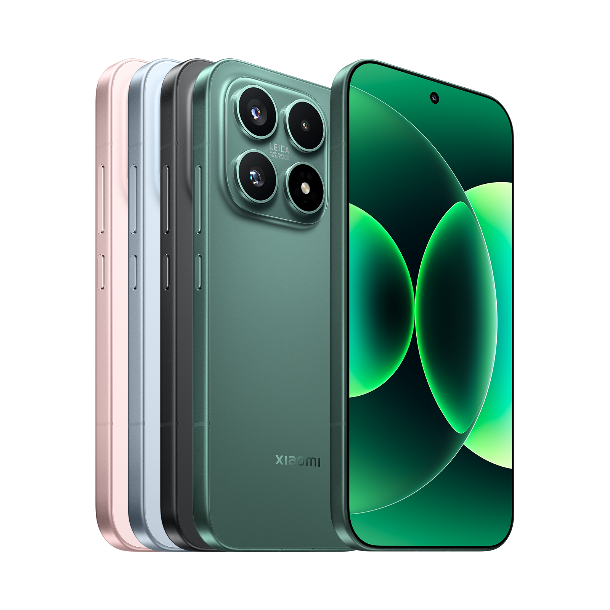

# device_xiaomi_pudding

<p align="center"></p>
<p align="center"><sub>Xiaomi 17 (image: Xiaomi)</sub></p>

Device tree for the **Xiaomi 17** (`pudding`, model 25113PN0EG, Snapdragon 8 Elite Gen 5 /
SM8850). Built on **LineageOS 24.0** (Android 17) as `lineage_pudding`.

> **Status: bring-up. Boots to LineageOS; hardware support is being tested.**

## Layout
- Series-wide configuration and the vendor-partition blobs:
  [device_xiaomi_sm8850-common](https://github.com/xiaomi17-pudding-dev/device_xiaomi_sm8850-common).
- This tree: screen density, OTA assert, odm props, the device part of the kernel cmdline,
  the product (`lineage_pudding.mk`) and the **odm-partition** blobs (camera, touch, sensors,
  audio calibration, …), listed in `proprietary-files.txt`.
- `fingerprint/`: device nodes of the ultrasonic under-display sensor and the extension
  interface its HAL module registers; the service itself is built by the common tree.
- Kernel: prebuilt stock GKI, DTBs and modules from
  [device_xiaomi_pudding-kernel](https://github.com/xiaomi17-pudding-dev/device_xiaomi_pudding-kernel).
- Blobs: [vendor_xiaomi_pudding](https://gitlab.com/xiaomi17-pudding-dev/vendor_xiaomi_pudding) (GitLab).
- MIUI camera app, its libraries and properties:
  [device_xiaomi_miuicamera-pudding](https://github.com/xiaomi17-pudding-dev/device_xiaomi_miuicamera-pudding),
  inherited from `device.mk` (the camera HAL blobs stay in this tree).

## Source firmware
HyperOS **OS3.0.335.0.XPCEUXM** (EEA global), odm build
`Xiaomi/pudding_global/pudding:16/BQ2A.260225.001-BP2A.250705.008/OS3.0.335.0.XPCMI:user/release-keys`.

## Build
See [local_manifests_pudding](https://github.com/xiaomi17-pudding-dev/local_manifests_pudding).

## Updating to a new firmware
The trees, the blobs and the prebuilt kernel always come from **one** stock firmware, and the
phone must run that firmware's bootloader, modem and other firmware partitions. To move to a
newer HyperOS release:

1. **Unpack** the official fastboot ROM: `super.img` (`lpunpack`), then the EROFS images of
   `vendor`, `odm`, `system`, `system_ext`, `product`, `vendor_dlkm` and `system_dlkm` into one
   directory, plus the boot images (`boot`, `init_boot`, `vendor_boot`, `dtbo`).
2. **Kernel first.** In
   [device_xiaomi_pudding-kernel](https://github.com/xiaomi17-pudding-dev/device_xiaomi_pudding-kernel)
   run `./extract-files.sh <unpacked-firmware>` (kernel image, DTBs, DTBO and the
   `vendor_boot`/`vendor_dlkm`/`system_dlkm` modules with their load lists). Modules and kernel
   only work as a matched set.
3. **Blobs.** In an Android source tree:
   ```bash
   cd device/xiaomi/pudding
   ./extract-files.py <unpacked-firmware>
   ```
   This extracts the files of both `proprietary-files.txt` (common and device) from the new
   firmware; `git diff` in `vendor/xiaomi/sm8850-common` and `vendor/xiaomi/pudding` then shows
   which blobs changed. Review them file by file. Files missing from the new firmware make the
   extraction fail and must be removed (or replaced) on purpose; new services need a new entry.
   An entry may be pinned (`|<sha1>`) only to keep a blob from another firmware on purpose,
   with a comment saying why: extraction keeps the pinned version instead of the new one.
   Entries marked `DISABLE_CHECKELF` (libraries opened by file name whose stock `DT_SONAME`
   differs) skip the build's dependency check: compare their `readelf -d` NEEDED entries
   with the image by hand.
   Run `./extract-files.py <unpacked-firmware>` in `device/xiaomi/miuicamera-pudding` as well
   for the MIUI camera blobs (`vendor/xiaomi/miuicamera-pudding`).
4. **Firmware-derived values.** Compare and update what is copied from the stock firmware:
   - `VENDOR_SECURITY_PATCH` (BoardConfigCommon.mk) = stock `ro.vendor.build.security_patch`;
   - `swinfo.fingerprint` (BoardConfig.mk) and the stock `vendor_boot` cmdline/bootconfig
     (BoardConfigCommon.mk);
   - `*.prop`, `config.fs`, overlays, `manifest.xml` and the compatibility matrices;
   - `sepolicy/vendor` of the common tree (derived from the stock vendor policy);
   - AIDL interface versions the blobs link against (`REQUIRED=` entries in the blob lists).
5. **Commit** in the vendor repositories as "Update blobs to &lt;firmware&gt;" and tag them with
   the firmware name; update the "Source firmware" sections of all READMEs.

## Credits
Structure follows the LineageOS Xiaomi SM8550 trees
([android_device_xiaomi_fuxi](https://github.com/LineageOS/android_device_xiaomi_fuxi)).
Initially generated with [aospdtgen](https://github.com/SebaUbuntu/aospdtgen).

## License
Apache-2.0. Proprietary files are redistributed as shipped in the stock firmware above.
